<picture>
  <source media="(prefers-color-scheme: dark)" srcset="./assets/banner-dark.svg">
  <source media="(prefers-color-scheme: light)" srcset="./assets/banner-light.svg">
  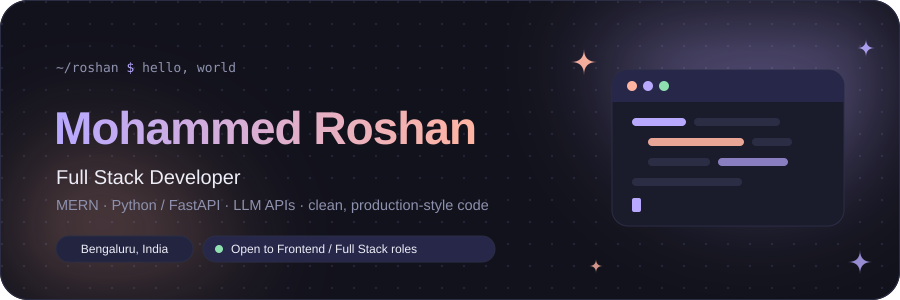
</picture>

 

I build products end to end, from database schema to deployed UI, with clean, production-style code rather than demo-ready code. Lately that means pairing the **MERN** stack with **Python / FastAPI** and **LLM APIs** to build systems that reason about data, not just display it.

B.E. in Computer Science & Engineering (2025) from Rural Engineering College, Hulkoti, Gadag. 150+ DSA problems solved on LeetCode and GeeksforGeeks. Currently looking for a **Frontend / Full Stack Developer** role.

 

<picture>
  <source media="(prefers-color-scheme: dark)" srcset="./assets/h-work-dark.svg">
  <source media="(prefers-color-scheme: light)" srcset="./assets/h-work-light.svg">
  
</picture>

<table width="100%" cellspacing="0" cellpadding="0">
<tr>
<td width="50%" valign="top">
<a href="https://github.com/md-rosh02/laborloom">
<picture>
  <source media="(prefers-color-scheme: dark)" srcset="./assets/plate-laborloom-dark.svg">
  <source media="(prefers-color-scheme: light)" srcset="./assets/plate-laborloom-light.svg">
  
</picture>
</a>
</td>
<td width="50%" valign="top">
<a href="https://github.com/md-rosh02/codereview-ai">
<picture>
  <source media="(prefers-color-scheme: dark)" srcset="./assets/plate-codereview-dark.svg">
  <source media="(prefers-color-scheme: light)" srcset="./assets/plate-codereview-light.svg">
  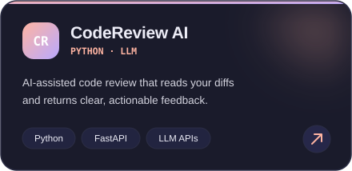
</picture>
</a>
</td>
</tr>
<tr>
<td width="50%" valign="top">
<a href="https://github.com/md-rosh02/threadco">
<picture>
  <source media="(prefers-color-scheme: dark)" srcset="./assets/plate-threadco-dark.svg">
  <source media="(prefers-color-scheme: light)" srcset="./assets/plate-threadco-light.svg">
  
</picture>
</a>
</td>
<td width="50%" valign="top">
<a href="https://github.com/md-rosh02/chess">
<picture>
  <source media="(prefers-color-scheme: dark)" srcset="./assets/plate-chess-dark.svg">
  <source media="(prefers-color-scheme: light)" srcset="./assets/plate-chess-light.svg">
  
</picture>
</a>
</td>
</tr>
</table>

<picture>
  <source media="(prefers-color-scheme: dark)" srcset="./assets/divider-dark.svg">
  <source media="(prefers-color-scheme: light)" srcset="./assets/divider-light.svg">
  
</picture>

<picture>
  <source media="(prefers-color-scheme: dark)" srcset="./assets/h-stack-dark.svg">
  <source media="(prefers-color-scheme: light)" srcset="./assets/h-stack-light.svg">
  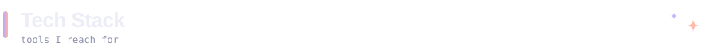
</picture>

<picture>
  <source media="(prefers-color-scheme: dark)" srcset="./assets/stack-dark.svg">
  <source media="(prefers-color-scheme: light)" srcset="./assets/stack-light.svg">
  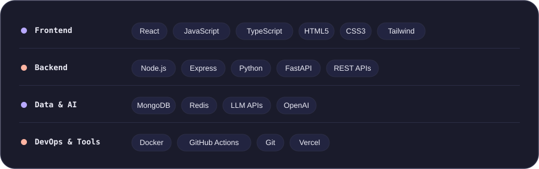
</picture>

<picture>
  <source media="(prefers-color-scheme: dark)" srcset="./assets/divider-dark.svg">
  <source media="(prefers-color-scheme: light)" srcset="./assets/divider-light.svg">
  
</picture>

<picture>
  <source media="(prefers-color-scheme: dark)" srcset="./assets/h-exp-dark.svg">
  <source media="(prefers-color-scheme: light)" srcset="./assets/h-exp-light.svg">
  
</picture>

<picture>
  <source media="(prefers-color-scheme: dark)" srcset="./assets/experience-dark.svg">
  <source media="(prefers-color-scheme: light)" srcset="./assets/experience-light.svg">
  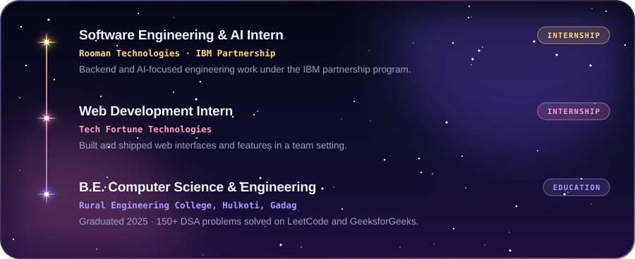
</picture>

<picture>
  <source media="(prefers-color-scheme: dark)" srcset="./assets/divider-dark.svg">
  <source media="(prefers-color-scheme: light)" srcset="./assets/divider-light.svg">
  
</picture>

<picture>
  <source media="(prefers-color-scheme: dark)" srcset="./assets/h-num-dark.svg">
  <source media="(prefers-color-scheme: light)" srcset="./assets/h-num-light.svg">
  
</picture>

<picture>
  <source media="(prefers-color-scheme: dark)" srcset="./assets/numbers-dark.svg">
  <source media="(prefers-color-scheme: light)" srcset="./assets/numbers-light.svg">
  
</picture>

 

<picture>
  <source media="(prefers-color-scheme: dark)" srcset="./assets/footer-dark.svg">
  <source media="(prefers-color-scheme: light)" srcset="./assets/footer-light.svg">
  
</picture>

